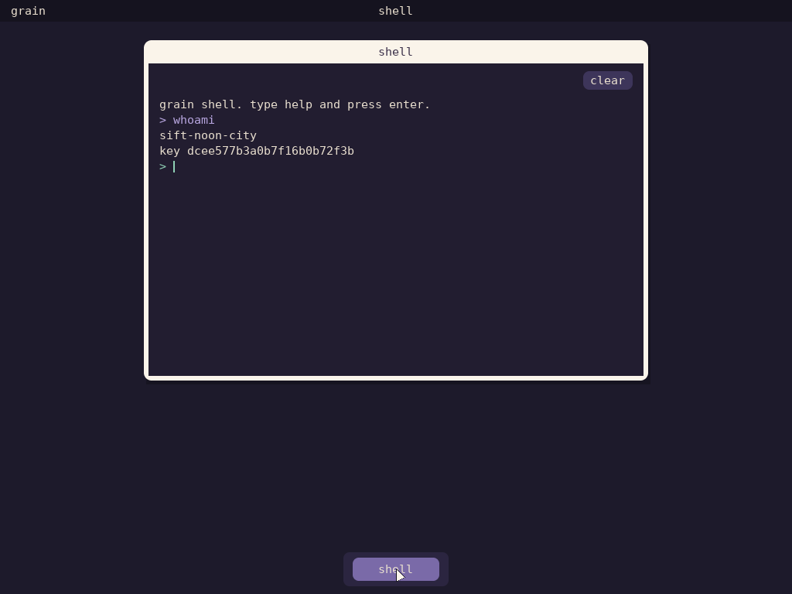

# Grain OS

Grain is a capability operating system written in Zig. It aims to be
deterministic, secure, and easy for an AI to operate. Its microkernel is
**Caravan**.

Grain is designed to be **intimate** (local-first, owner-held keys),
**social** (share by handing over a capability), **secure** (no ambient
authority, a minimal kernel), **clear** (typed, self-describing interfaces;
an audit ledger), and **loyal** (it answers to its owner only).

RISC-V is the primary target; aarch64 runs the kernel; x86_64 follows.

> Now: **Grain in a browser.** `grain-emu` (`emu/`) is an emulated RISC-V
> machine that boots the same images as QEMU; compiled to WebAssembly, it
> runs the system in a web page (`zig build web`, docs/WEB.md).
>
> Status: **Phase 9: hardening.** Every way into the kernel and every
> parser of untrusted input is fuzzed (Zig's coverage-guided fuzzer, and a
> seeded sweep in every test run); a model checker tries every order of
> every call in small IPC and revocation scenarios on the real kernel core;
> boots through Aurora are measured, recorded in the Ledger and attested by
> the instance's identity; IPC hands off without the run queue. The
> capability model is written up for an external reviewer
> (docs/CAPABILITY_MODEL.md).
>
> Phase 8: reach. Grain drives the hardware a PC has as well
> as virtio: Steward owns the PCI Express bus and hands each function to
> the domain the manifest names; NVMe storage, Intel Ethernet, a linear
> framebuffer, and USB keyboards and tablets over xHCI each have a native
> driver in the domain that uses them. Caravan runs on Arm (aarch64, QEMU
> virt) as well as RISC-V: the same portable core passes the same kernel
> suite on both.
>
> Phase 7: the social layer. Grain instances find each other on
> the network and open sessions keyed by their identities (Noise XX; the
> identity key never leaves Kumara). An owner lends another person a hosted
> application or a file: a sturdy reference backed by a kernel lease, used
> from the other side as an ordinary typed capability, recorded in the
> Ledger, and revocable.
>
> Phase 6: a personal desktop. Grain boots to a desktop that
> Surf, its compositor, paints from typed brushstrokes: applications
> describe their windows as fills, panels and lines of text with roles, so
> the whole screen reads back as data, and an agent sees what the owner sees
> without guessing from pixels. The first application is a shell, opened
> from the dock.
>
> 
>
> Phase 5: Grain keeps things. A content store (Tablecloth)
> survives a power cut at any instant and seals private data under the
> owner's passphrase; each instance has an identity (Kumara) with a
> three-word name; a signed Ledger records what the agent does; and whole
> systems are generations that Aurora boots on trial, upgraded and rolled
> back by an agent, with automatic fallback.
>
> Phase 4: an AI agent operates Grain. Caravan is a working
> capability microkernel on QEMU `virt` (riscv64, SMP). On top of it,
> **Steward** builds a whole system from a declarative manifest, checked at
> compile time and packed into a BLAKE3-hashed boot image. Interfaces are
> typed Zig declarations that describe themselves; the kernel checks their
> ids on every endpoint. **Envoy** lets an agent on the host discover, plan,
> apply and undo typed calls, using only the leases the manifest gives it,
> with every action in a hash-chained audit log. An MCP bridge and a
> structured shell sit on the same protocol. Systems are declared in
> **Brix**, a small manifest language that evaluates to checked plain data.

## Quick start

```sh
tools/setup.sh        # Zig 0.17.0, QEMU, OpenSBI, gdb-multiarch (Debian/Ubuntu)
zig build test        # host: unit tests, kernel scenario tests, short simulator run
zig build qemu-test   # QEMU, 2 harts: kernel suite, the dev system, an agent session, the desktop, two
                      # instances sharing over the network, storage,
                      # generations through Aurora, faults, a miswired manifest
zig build run         # boot the dev system through Aurora, in real time, on a disk that persists
                      # (type its passphrase); it prints an Envoy socket to connect to
python3 tools/envoy.py shell --socket PATH   # grainsh: operate the running system
python3 tools/envoy.py mcp --socket PATH     # the same, as MCP tools for an agent
zig build sim         # deterministic simulator: random events, invariants every step
zig build bench -Doptimize=ReleaseFast   # benchmark and kernel-profile records
```

```
@grain steward_start system=grain-dev domains=8 programs=8 harts=2 closure=… verified=true
@grain driver_ready domain=console device=virtio_console mmio=0x10007000 irq=7
@grain driver_ready domain=rng device=virtio_rng mmio=0x10008000 irq=8
@grain domain_fault domain=flaky kind=store_page_fault addr=0x10 pc=0x27d24 restarts=0
@grain domain_start domain=flaky program=flaky … restart=1
@grain echo_ok domain=checker answer=42 badge_seen_by_server=5
@grain hello domain=hello entropy=00f3e6dacdc0b4a7 console_bytes=43
@grain summary tests=2 failed=0
console| hello from grain! entropy 00f3e6dacdc0b4a7
console| checker: flaky.echo answered 42
```

With an agent attached (`grainsh`; `describe` output abridged):

```
grain> caps
name     protocol    granted  askable  uses_left  expires_in_ms
echo     echo.v1     True     False    -          3286
store    kv.v1       True     False    -          -
console  console.v1  True     False    20         -
entropy  entropy.v1  False    True
grain> describe store
kv.v1: A small in-memory key-value store (64-bit keys and values). Every write can be undone.
  put(key: u64, value: u64) -> (previous: u64, had: bool)  [mutates, undo=restore]  Set a key; returns what it held before.
grain> call store put key=7 value=70
{"previous": 0, "had": false}
grain> undo 1
{"undone": 1}
grain> call store.get key=7
{"value": 0, "found": false}
grain> log
seq  verb  cap    method   outcome  undo_of  undone
1    call  store  put      ok                True
2    undo  store  restore  ok       1        False
3    call  store  get      ok                False
hash chain: verified  head f82b57c52ddf0fb7...
```

## Documents

- [docs/ARCHITECTURE.md](docs/ARCHITECTURE.md): the design of Caravan and Grain
- [docs/PLAN.md](docs/PLAN.md): phased roadmap and open questions
- [docs/TESTING.md](docs/TESTING.md): how each layer is built, booted, tested and driven
- [docs/MAC.md](docs/MAC.md): getting ready to run and use Grain on a Mac, safely
- [docs/WEB.md](docs/WEB.md): Grain in a browser: the page, how it works, publishing it
- [docs/CAPABILITY_MODEL.md](docs/CAPABILITY_MODEL.md): the capability model, written for an external reviewer
- [docs/BRIX.md](docs/BRIX.md): Brix, the language manifests are written in
- [docs/GLOSSARY.md](docs/GLOSSARY.md): the proposed names (Tally, Pond, Rishi, Brix, …) and what each maps to
- [docs/RESEARCH.md](docs/RESEARCH.md): what we took from seL4, Hubris, Zircon, NixOS, Linux, TigerBeetle and others

## Layout

```
build.zig                    build graph (kernel, root task, host tests, simulator, QEMU steps)
caravan/abi/abi.zig          the system-call contract shared by kernel and user programs
caravan/src/core/            portable kernel core: kernel.zig (state machine), fdt, elf, klog
caravan/src/arch/riscv64/    boot (Sv39, higher half), traps, SBI, PLIC, the arch interface
caravan/src/main.zig         riscv64 glue: harts, kernel lock, traps → kernel.handle
grain/lib/                   libgrain: system calls, domain environment, virtio, the IDL (idl.zig)
grain/proto/                 protocols as Zig declarations: console, entropy, echo, kv, registry
grain/manifest/              manifest schema + validator, boot-image format
grain/steward/main.zig       Steward: builds and supervises the system from the manifest
grain/programs/              drivers (virtio_console, virtio_rng), registry, kv, envoy, tablecloth,
                             kumara, ledger, test programs
grain/ktest/main.zig         the kernel test suite (root task of caravan-ktest)
system/                      manifests in Brix: dev.brix, tests/faults.brix, tests/miswired.brix
aurora/                      Aurora: the boot stage that loads a generation from the disk
grain/lib/tablecloth.zig     Tablecloth, the content store (and its crash simulator)
grain/lib/kumara.zig         identity names (the word bank) and signing
grain/lib/generation.zig     generations: content-chunked system images
tools/disk/                  grain-disk: format, show, add and pack generations
grain/brix/                  Brix, the manifest language (tools/brix: check, print, write ZON)
tools/pack/                  grain-pack: manifest + programs -> hashed boot image
sim/                         simulated machine, scenario tests, caravan-sim
tools/harness.py             boots QEMU, parses records, drives agent scripts, sets the exit status
tools/envoy.py               Envoy client library, grainsh, MCP bridge
tools/agent_session.py       the agent session run by qemu-test
tools/setup.sh               toolchain installer
```
