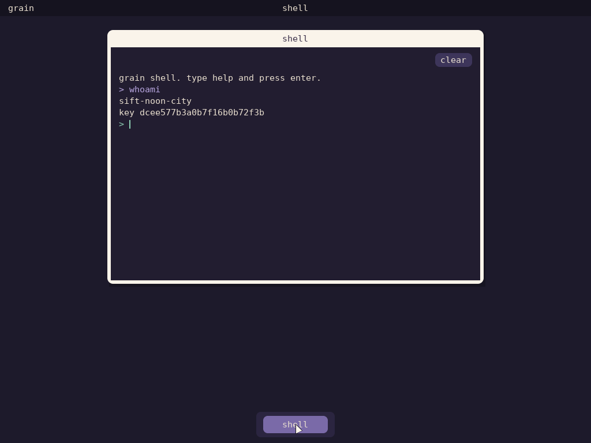

# Grain OS architecture (draft 0)

> **Status:** proposal. Names other than *Grain* and *Caravan* are working
> titles; [GLOSSARY.md](GLOSSARY.md) maps the owner's proposed names onto
> them (code keeps the current names until the rename after Phase 4).
>
> **Owner decisions (2026-10-16):** Grain is a **personal-device** OS first.
> *Social* means every instance has a shareable cryptographic identity, used
> to move data, host applications and connect with other people's instances
> (inspired by Urbit). There is **no compatibility layer**: no Linux guest, no
> POSIX. Everything is native, and hardware is reached through native drivers.

## 1. What Grain is

Grain is a capability operating system built around three claims:

1. **The system is a value.** A Grain system is fully described by a
   declarative *manifest*. Building the manifest gives a content-addressed,
   reproducible image (as in NixOS). What runs is exactly what was declared,
   and every change is a transaction you can roll back.
2. **Authority is explicit and owned.** Nothing can act unless it holds a
   capability. All authority starts with the owner and is delegated in
   narrow, revocable slices to programs, people and AI agents (as in seL4 and
   object-capability systems).
3. **The kernel is a deterministic state machine.** All nondeterminism
   (interrupts, time, entropy, device input) enters through one recorded
   door. The same history gives the same state, on hardware or in a simulator
   (as in TigerBeetle's deterministic simulation testing).

### The five qualities, as engineering constraints

| Quality | What it means in the design |
|---|---|
| **Intimate** | Local-first. The owner's data lives on the owner's device, encrypted with keys the owner holds. The OS keeps a rich, private context about its owner (files, history, preferences) and shares none of it without a capability grant. |
| **Social** | Every Grain instance has its own cryptographic identity (*Kumara*) that its owner can share. Instances address each other by identity, not by IP. Sharing is handing someone a capability, not editing ACLs. Capabilities cross instances as signed *sturdy references* with local *petnames*. Apps are hosted on the owner's own instance, and friends reach them there. |
| **Secure** | No ambient authority. A minimal kernel (target under 10k lines of Zig). Drivers and services are unprivileged and isolated by the MMU and, later, the IOMMU. Measured boot of a content-addressed image. Static allocation in the kernel. |
| **Clear** | Every interface is typed and self-describing. Every authority-changing event goes into an append-only, hash-chained *Ledger*. Every change has a plan you can preview, then an apply, then an undo. The kernel's own output is structured records. |
| **Loyal** | The OS serves its owner only. No hidden authority for vendors. Updates are content-addressed and applied only with the owner's approval. Agents act only through leases the owner granted, and the owner can see everything they did. |

## 2. Caravan, the microkernel

Caravan does five things and nothing else: **capabilities, memory,
execution, IPC, and the event door.** Everything else, drivers included, runs
in userspace.

> **Status (Phase 2):** everything in this section is implemented and tested
> unless marked *planned*. Where the build differs from the first draft of this
> design, the text says so and why. The ABI is `caravan/abi/abi.zig`, and the
> core is `caravan/src/core/kernel.zig`.

### 2.1 Kernel objects

| Object | Purpose |
|---|---|
| `Untyped` | A range of physical memory that can be retyped into other objects. The only source of kernel memory. Device untypeds (MMIO) can only become frames. |
| `CNode` | A table of 2^n capability slots. A thread's CSpace is one CNode for now (multi-level lookup is *planned*). |
| `Thread` | Saved registers, a CSpace, an address space, an optional fault endpoint and IPC buffer, a priority and a maximum controlled priority. |
| `PageTable` | One Sv39 table at a fixed level (given when created). A top-level table *is* an address space: its methods map frames and link tables. |
| `Frame` | 4 KiB, 2 MiB or 1 GiB of memory (RAM or device). |
| `Endpoint` | Synchronous IPC rendezvous (call/reply, send/recv). |
| `Signal` | An asynchronous notification word (seL4 notifications): OR in bits, wait for any. Interrupts arrive as signals. |
| `SchedContext` | A CPU-time budget and period on one hart (seL4 MCS). Time is a capability. It counts every tick charged to it (`info`: budget, period, ticks consumed, hart, throttled). |
| `Lease` | A revocable, limited forwarder to another capability (§2.3). |
| `Irq` | The right to receive one interrupt line as a signal. |
| `IrqControl`, `SchedControl`, `DebugConsole` | Boot singletons: the authority to create Irqs, to give contexts budgets, and (for bring-up) console output and power-off. |
| `Channel` | *Planned:* shared-memory rings plus a signal, for bulk data. |

*Change from the first draft:* there is no `Domain` object. As in seL4, a
thread names its CSpace and address space directly, and threads can share
them. "Domain" stays a manifest-level idea (Phase 3): a group of threads,
spaces and capabilities that Steward creates together.

### 2.2 Capabilities

A capability is 16 bytes, stored only in kernel-owned CNodes:

```
object index : u32   which entry in the object table
generation   : u32   must equal the entry's current generation
rights       : u16   read write execute grant send recv revoke configure retype
protocol     : u16   interface id: an endpoint delivers only between matching ids
badge        : u32   delivered to the receiver with every message or signal
```

- **Unforgeable:** userspace names capabilities by slot index only.
- **Attenuation:** `CNode.mint` copies a capability with a subset of its
  rights, and can set a badge once and a protocol id once. Rights only shrink.
- **Protocol checks:** an endpoint refuses a message whose sender's protocol
  id differs from the waiting receiver's (both nonzero), with
  `protocol_mismatch`; a queued sender is refused the same way when the
  receiver arrives. Steward stamps the low 16 bits of the IDL hash (§3.2) on
  every endpoint it hands out, so a client built against `kv.v1` cannot
  talk to a server serving `echo.v1`, whatever slot it was given.
- **Protocols are delivered:** the receiver gets the sender's protocol id
  with the badge (`a7` bits 32..47). A domain serving several protocols
  receives on one unstamped endpoint and dispatches on that id
  (`idl.serveAll`), so a label is only ever read as a method of the protocol
  the caller actually holds. Steward gives each domain one endpoint for all
  its services; a domain of one protocol keeps its receive side stamped, so
  the kernel still refuses strangers before they reach it.
- **Introspection:** `CNode.identify` returns the kind, rights, badge, the
  kind *behind* a lease, and the object id; `CNode.lease_info` returns a
  lease's remaining uses and expiry. Agents can ask any slot what it is.
- **The object table** has one 32-byte entry per object, allocated once at
  boot (about one entry per 4 KiB of RAM, so 0.8% overhead). Generations
  live in the table, not in the object's memory, so they survive memory reuse.

### 2.3 Revocation: generations and leases, no derivation tree

seL4 tracks every derived capability in a derivation tree. Caravan does not.
(The whole model, its claims and what checks each, written for an external
reviewer: docs/CAPABILITY_MODEL.md.)

- **`CNode.revoke(slot)` bumps the object's generation.** Every other
  capability to it, anywhere, becomes invalid at once; the revoking slot gets
  a fresh one. Threads queued on a revoked endpoint or signal are woken with
  `aborted`; a revoked frame is unmapped. **O(1) apart from that cleanup.**
- **Generations never come round** (Phase 9). They are 32 bits. A table
  entry whose last generation is reached when its object is destroyed is
  retired (never handed out again), and a revoke that would leave it no
  generation is refused (`invalid_state`), so a stale capability can never
  match again. The cost: one table entry per 2^32 lifetimes.
- **Selective revocation uses leases.** `Lease.arm(target, rights,
  duration, uses)` makes a lease forward to a capability. Copies of the lease
  capability act as the target, with at most the lease's rights, until the
  duration passes, the uses run out, or the owner revokes the lease. This is
  the caretaker pattern from KeyKOS and E, in the kernel.
- **Capabilities the kernel keeps for a thread** (fault endpoint, IRQ
  signal) are stored unresolved and resolved through leases on every use, so
  revoking a lease cuts them off too.
- **Known limit:** a lease controls *invocations*. An effect that outlives an
  invocation, such as a mapping made through a leased frame capability or a
  scheduling context bound through one, is not undone when the lease ends.
  To take that back, revoke the underlying object instead.
- **Memory is reclaimed by `Untyped.reset`,** which destroys every object
  made from the region (recursively, iteratively, cost proportional to the
  number of objects) and undoes each one's relationships: dequeues threads,
  aborts waiting callers, returns lent contexts, unmaps frames and tables,
  and stops harts running a destroyed thread or address space.

### 2.4 Memory

- **No kernel heap.** At boot Caravan parses the device tree, places the
  object table and the root untyped headers in free RAM, turns the rest of
  RAM into untyped regions, and makes device untypeds from device-tree MMIO
  ranges (excluding the interrupt controller and timer). After boot, every
  kernel object lives in memory a caller retyped.
- **Untyped regions allocate from both ends:** page-aligned payloads (frames,
  tables, big CNodes, child regions) from the bottom, small bodies (threads,
  endpoints, signals, contexts, leases) from the top, so alignment wastes
  nothing. Each region also has an **object budget** (one object per 4 KiB of
  its size), so nobody can exhaust the global object table with tiny objects.
- **Page tables carry a shadow array** naming the object mapped or linked at
  each slot (a table is 8 KiB: 4 KiB of PTEs, then the shadow). Frames and
  tables record where they are mapped. Destroying either side finds and
  clears the other. *Limit:* a frame object is mapped in one place; sharing
  memory between address spaces needs frame aliases (*planned*, with channels).
- **Kernel mapping:** the kernel is linked at `0xffffffff80200000`, and all
  physical memory is mapped at `0xffffffc000000000`, both with 1 GiB pages
  built by the boot code. New root tables copy the kernel half.
- **Faults go to userspace:** page faults and exceptions become messages on
  the thread's fault endpoint (kind, address, pc). The handler can map memory
  and reply to retry, or reply with a new pc. With no handler the thread stops,
  and the kernel logs a `thread_fault` record.

### 2.5 Execution and scheduling

- **MCS scheduling contexts:** a thread runs only on a configured context
  (budget ≤ period, on one hart). The running thread is charged at every
  kernel entry, and exhaustion is handled right there, whatever the thread
  goes on to do in that entry. A full-bandwidth context (budget = period)
  refills and its thread goes to the back of its queue; any other context is
  throttled and placed on its hart's release list until the next refill. Refills follow a simple
  periodic rule; seL4's sporadic-server refills are *planned*.
- **Donation:** a call to a passive server (one with no context of its own)
  lends the caller's context. The reply gives it back. Servers run on their
  clients' time.
- **Priorities 0–255** with a per-thread *maximum controlled priority*, so a
  thread can lower itself and later restore itself.
- **Per-hart run queues** with a priority bitmap. A context's hart decides
  where its thread runs.
- **Timer programming is lazy:** the hardware timer only moves earlier. An
  early timer interrupt is a cheap no-op, and it saves a firmware call on
  almost every kernel entry.
- *Change from the first draft:* SMP uses **one kernel lock** (as seL4 does)
  rather than shared-nothing per-hart kernels. Kernel entries are short and
  non-preemptible. Other harts are told to reschedule with IPIs ("kicks").
  The hart holding the lock waits until any kicked hart running user code
  has trapped, so no hart keeps running a thread the kernel took away.
  Destroying an address space makes every hart leave that root table before
  the call returns. A multikernel design stays the long-term direction.
- **TLB shootdowns are targeted.** A page-table change flushes only harts
  whose *active* root is the root the changed table hangs under; a table not
  yet linked to any root needs no flush at all. That is sound because
  switching roots flushes the hart's TLB (there are no ASIDs yet) and roots
  only change under the kernel lock. *Measured:* this took the dev system's
  boot under two harts from timing out at 60 s (every page Steward copied
  cost a remote fence to a hart that had nothing to flush) to a few seconds.
- **Logical harts.** Hart 0 is whichever hart firmware booted on (SBI may
  pick any); the others follow in device-tree order. Manifests and the core
  see only logical indices, and external interrupts go to hart 0.
- **Idle heartbeat.** When every hart is idle and no timer is armed (all
  threads wait on devices), the arch layer arms a 10 ms timer. Under QEMU
  `-icount` a machine in that state never receives the host's I/O
  completion (a disk flush waited forever); a pending deadline keeps QEMU's
  clock and I/O moving. On hardware it is one interrupt per 10 ms of total
  idleness.
- *Planned:* a static time-partitioned scheduling mode for fully
  deterministic systems.

### 2.6 IPC

- `call`, `send`, `recv`, `reply_recv`, `reply`: a message tag and five
  words travel in registers. Up to 64 words go through the thread's IPC
  buffer page. Up to four capabilities move per message if the sender's
  endpoint capability has the `grant` right.
- The reply relationship is implicit (one outstanding caller per server). A
  server that takes a new call without replying aborts the old caller.
- `signal`, `wait`, `poll` on signals. An `Irq` bound to a signal sets the
  signal's badge bits, and stays masked until `Irq.ack`.
- **Bound signals.** `Thread.bind_signal` ties one signal to one thread:
  while that thread waits to receive on any endpoint, the signal firing
  ends the wait too (a7 bit 63 says so; the bits arrive in word 0), and a
  signal already pending ends the next receive at once, ahead of queued
  senders. So one thread, on one scheduling context, serves its clients and
  its devices' interrupts with no polling and no second thread (Surf, the
  compositor, waits this way on its clients, its GPU and its input
  devices). Bindings are symmetric and undone when either side is revoked
  or destroyed; the invariants check both, and that no receiver ever waits
  while its bound signal is pending.
- **Alarms.** `Signal.alarm(ticks)` fires the signal after `ticks` timer
  ticks, as if signalled through that capability (its badge, or 1); arming
  again replaces the alarm and 0 cancels it. Each hart keeps armed signals
  in a list sorted by time, beside its scheduling-context release list, and
  programs its timer for whichever comes first; time reaches the kernel only
  through the event door, so alarms are as deterministic as everything else.
  With a bound signal, a server's receive ends on a message, an interrupt or
  a timeout (Comlink's retransmits, §3.7). The invariants check that every
  armed alarm is on its hart's list, in order.
- **Direct hand-off** (Phase 9). A thread made runnable on the hart that
  is handling the kernel entry (the server a call wakes, the caller a reply
  wakes, a thread that yields) is held aside instead of queued; the entry's
  reschedule runs it at once if nothing as urgent is queued, and otherwise
  queues it exactly where it would have gone, and any other enqueue on that
  hart first puts it in its place. So the queue's order and every
  scheduling decision are what they were (the simulator makes the same
  decisions on every seed), and an IPC round trip no longer touches the run
  queue. The invariants check nothing is held aside between entries.
- **Measured** (QEMU, one hart, ReleaseFast, instructions retired including
  user code; `zig build bench`): `yield` about 660 (747 before the direct
  hand-off), a minimal object method about 810, a call/reply round trip to
  a passive server about 2,070 (2,261 before). Inside the kernel core:
  `call` 713 and `reply_recv` 704 instructions (802 and 808 before). The
  per-function profile of the round trip comes from `caravan-profile` under
  callgrind (`sim/profile.zig`): what remains is spread over capability
  resolution, message copy, scheduling-context accounting and the timer,
  none dominant. A register-only fastpath that skips the general scheduler
  (like seL4's) is *planned*; the target is still a few hundred cycles per
  round trip on real RVA23 cores, which are not at hand.

### 2.7 The event door (determinism)

Architecture code turns hardware into events and calls one portable entry
point:

```
kernel.handle(hart, now, event)        event = syscall | fault | timer | irq(line) | ipi
kernel.currentThread(hart)             what that hart should run next (or idle)
```

- Every effect goes through a small comptime interface (`A` in kernel.zig):
  set a timer, mask an IRQ, flush the TLB, retire a root table, write the
  console. Time is an argument, never read by the core. Power-off is a
  request (`exitRequested`) that arch code carries out.
- `core/` can't import `arch/`, and the build enforces it. The same core runs:
  - **on QEMU riscv64** (and, later, hardware);
  - **in host scenario tests** (`sim/kernel_test.zig`) that act as user
    threads by setting registers and calling `handle`;
  - **in `caravan-sim`**, which feeds the core seeded random events and
    checks `checkInvariants()` (queues, states, reply links, contexts,
    mappings, untyped watermarks, free list) after every step. Any seed
    replays bit-for-bit, and each run is executed twice to prove it.
- QEMU runs use `-icount`, so a whole-system boot, SMP included, gives
  byte-identical output every time.
- *Planned:* ledger mode (record every event in order, for replay and audit).

### 2.8 System calls

Ten calls: `call`, `send`, `recv`, `reply_recv`, `reply`, `signal`,
`wait`, `poll`, `yield`, and `invoke(cap, method, args)` for object methods.
Methods, error codes, thread states and fault kinds are named enums in the
ABI file, so a person or an agent can read the whole contract in one place.

The debug console's `write` takes up to 32 bytes in registers, or up to 512
(`abi.max_debug_write`) from the caller's IPC buffer, and writes each call
whole. libgrain formats a record line and writes it in one call, so records
from different harts never interleave — the harness parses lines, and a torn
line is a lost record.

## 3. Grain, the system above the kernel

```
┌──────────────────────────────────────────────────────────────────┐
│ apps · agents (via Envoy) · structured shell · desktop           │
├──────────────────────────────────────────────────────────────────┤
│ Kumara (identity) · Comlink (sessions) · Mycelium (network)      │
├──────────────────────────────────────────────────────────────────┤
│ Envoy (agent interface) · Registry (schemas) · Ledger (audit)    │
│ Tablecloth (content store) · Steward (manifest, lifecycle)       │
├──────────────────────────────────────────────────────────────────┤
│ drivers (virtio-console/blk/net/gpu/input/rng; native later)     │
├──────────────────────────────────────────────────────────────────┤
│ Caravan: caps · memory · threads · IPC · event door              │
├──────────────────────────────────────────────────────────────────┤
│ arch: riscv64 (first) · aarch64 · x86_64   │   firmware: SBI/UEFI│
└──────────────────────────────────────────────────────────────────┘
```

### 3.1 Manifest, image, Steward (from NixOS, Hubris and Microkit)

> **Status (Phase 3, extended in 5):** implemented and tested, except the
> spawner, which is *planned*. Generations are §3.8.

**The manifest** is written in **Brix** (`system/*.brix`, see
[BRIX.md](BRIX.md)) and evaluates to plain data typed by
`grain/manifest/schema.zig`. The build runs `brix` to check it and write that
data as ZON, which grain-pack hashes and Steward embeds. It lists domains, and for each one: its program, kind (`service`
or `task`), priority, hart, CPU budget and period, memory, restart policy,
the services it provides (name and protocol), the services it uses
(`"<domain>.<service>"` and the protocol it expects), its devices (by virtio
id, PCI class or both, and `instance`, counting devices of that kind in
device-tree or bus order; a device marked `optional` that the machine lacks
makes Steward skip the domain with `domain_skipped` instead of failing it,
and one marked `extra` lets the domain run without it, its record marked
`absent`), and whether it gets a
write-only debug console. An optional `agent` section says what an AI agent
may hold (§3.5).

```brix
domain hello {
    program = hello
    kind = task
    uses console { from = console.console, protocol = console.v1 }
    uses entropy { from = rng.entropy, protocol = entropy.v1 }
}
```

**One validator, two places.** `schema.validate` checks names, uniqueness,
that every use resolves to a provider, that protocols match, priority
ranges, budget ≤ period, memory sizes, known device ids, that each hart
promises at most 90% of its time, and that no cycle of synchronous calls
exists (which could deadlock). It returns one sentence naming the problem.
Steward runs it **at compile time**, so a miswired system does not build:

```
error: system manifest: domain 'hello' uses 'console.consol', but no domain provides it (write it as "<domain>.<service>")
```

and `brix` and the host tests run it at run time, so every message is
tested. Through `brix`, a message points at the block it names
(`miswired.brix:12:1: domain 'hello' uses ...`).
`zig build check-manifest -Dsystem=<file>` runs the compile-time check on
its own.

**The boot image** (`grain/manifest/image.zig`, written by `tools/pack`)
holds the manifest text and every program it names, each with its BLAKE3
hash, plus a **closure hash** over the manifest's hash and every
(name, hash) pair. The closure hash names the whole system, as a NixOS
store path does: the same inputs give the same hash. Steward recomputes
every hash at boot and refuses to start if any differs.

**Steward** is the root task. It:

1. Verifies the image and reports `steward_start closure=… verified=true`.
2. Finds `virtio,mmio` transports in the device tree (the kernel copies the
   DTB into the root task), probes each one's device id, and keeps their
   MMIO frames. It creates an `Irq` the first time a device is assigned.
3. Creates one endpoint per provided service *in its own memory*, so the
   endpoint outlives the provider's restarts.
4. Builds each domain in a **private untyped region** sized from the
   program, stack, tables and the manifest's `memory_kib`. That covers the
   CNode, root page table, program pages (copied through a scratch window),
   stack, IPC buffer, a `DomainInfo` page, a child untyped of `memory_kib`
   for the domain's own use, a scheduling context with the manifest's
   budget, and the thread. Each object is charged to the domain's region.
5. Wires capabilities with badges. A client gets its provider's endpoint
   with send and grant rights, badged with the client's number, so servers
   know who is calling. The provider gets receive rights. Drivers get
   their MMIO frame (mapped at a fixed address) and their `Irq`.
6. Serves the **lifecycle endpoint**. Tasks call it to exit with a code.
   Faults arrive on the same endpoint with a fault badge. A faulting domain
   is torn down by resetting its region, which destroys everything it was
   made of in one call. If its policy is `on_fault` and it is under
   `max_restarts`, it is rebuilt from its image (`DomainInfo.restart_count`
   tells it which run this is). Otherwise it is stopped, and **its
   endpoints are revoked**, so clients waiting on it are woken with
   `aborted` and later calls fail with `invalid_cap` instead of hanging.
7. With `halt_when_tasks_finish`, it prints one `domain_status` record per
   domain and a `summary` once every task has finished, then powers off.
8. Serves **`steward.v1`** itself, on the same endpoint: a manifest uses it
   as `steward.domains` (the name `steward` is reserved for this; no domain
   may take it). A client's capability carries a service badge (the flag
   and its domain number) and the protocol's id, so its calls never look
   like lifecycle messages. `system` gives the system's name, closure,
   harts and uptime; `domain(i)` each domain's program, kind, status,
   restarts, budget, region size and the CPU time charged to its
   scheduling context (Steward keeps a copy of each domain's context for
   this, as it keeps its CNode); `restart(i)` tears a domain down and
   builds it again, and `stop(i)` tears it down and revokes its services
   until a restart. A domain that comes back from stopped or failed has its
   clients' capabilities minted afresh into their CNodes (Steward kept
   those), so they work again; the agent's leases on it do not come back.
   Each is recorded (`domain_restart`, `domain_stop`, with who asked). The
   task manager holds it; nothing else does in the dev system.

**The domain contract** (`grain/lib/domain.zig`): fixed capability slots
(the domain's own CNode, address space, thread, memory and lifecycle
endpoint, then uses at 16+, provides at 24+, devices at 32+), fixed
addresses (program at 0x10000, devices at 0x7000_0000, `DomainInfo` at
0x7ff0_0000, the manifest's `stack_kib` of stack below 0x7fff_0000), and the `DomainInfo` page, which
names everything the domain was given: its uses and provides with
protocols and slots, its devices with MMIO address, IRQ line and slots,
its program hash and the system's closure hash, and (for a server) its
clients: the name behind each badge it will see. Programs look things up by
name (`grain.use("console")`, `grain.device("port")`). Nothing is wired by
an unwritten convention.

**Steward never blocks on a domain.** Domains tell it things on the
lifecycle endpoint (exit, an agent's `ask`, `ready`, the owner domain's
`pending` and `decide`) and it answers at once.
`ready` is how a domain asks whether the whole boot came up (the store
confirms a generation on trial only if it did) and then reports itself
settled; with `halt_when_tasks_finish`, Steward does not power off before
every domain marked `await_ready` has. A use of a provider that was already
skipped or failed gets no capability at all, so a call fails at once
(`invalid_cap`) instead of waiting on an endpoint nobody serves.

**Images carry loadable bytes only.** grain-pack keeps each program's ELF
header, program headers and segment bytes (no sections, symbols or debug
information), and the kernel embeds its root task the same way; the full
binaries stay in `zig-out` for gdb. The dev system's kernel image went from
31 MB to 8 MB.

- *Planned:* a **spawner** service with an explicit untyped budget, so
  dynamic programs (apps, agents) are a capability the manifest grants
  rather than an exception to it.

### 3.2 Typed interfaces and the Registry

> **Status (Phase 4):** implemented and tested.

- Interfaces are defined **as Zig declarations** in `grain/proto/` (`console`,
  `entropy`, `echo`, `kv`, `registry`). Each method is
  `idl.Method(.{ .label, .effect, .doc, .undo }, Params, Results)` with
  per-field docs. Field types are integers, bools, enums, `idl.Text(n)`
  (UTF-8; agents see a string) and `idl.Bytes(n)` (binary; agents see hex),
  up to 504 bytes. A message is up to 64 words each way, checked at compile
  time: the first five travel in registers, the rest through the IPC buffers
  (the kernel copies them, §2.6), so a 480-byte chunk is one call.
- A parameter may be an `idl.Cap`: a capability that travels with the call
  (through the IPC buffer, only over an endpoint capability with `grant`).
  The server receives it in `idl.recv_slot` and must move it to keep it;
  otherwise it is dropped after the handler. Agents hold no capabilities of
  their own, so Envoy refuses such methods. (An application hands Surf the
  signal to raise for its events this way, §3.9.)
- A server whose thread has a bound signal (§2.6) gets `impl.onSignal(bits)`
  for each wakeup that is not a message.
- `grain/lib/idl.zig` generates, at `comptime`, typed client calls
  (`idl.call(proto.kv.put, ep, .{ .key = 1, .value = 2 })`), server dispatch
  (`idl.serve(proto.kv, ep, impl)`, which calls `impl.put(params, caller)`
  with the caller's badge, and replies with an `ErrorCode` on error), the
  wire encoding, and a **canonical JSON descriptor**: every method, field,
  type, effect, undo method and doc.
- **Effects** say what a call does to the world: `pure` (reads only),
  `mutates` (changes the service's state), `external` (output, devices; it
  can't be taken back). A `mutates` method may name its **undo** method,
  whose parameters are filled by name from the call's results, then its
  arguments (`kv.put` returns `previous, had`; `kv.restore` takes
  `key, previous, had`). Agents plan with this (§3.5).
- A protocol's id is the FNV-1a hash of its descriptor; the kernel checks its
  low 16 bits on endpoints (§2.2). Changing anything an agent could rely on,
  even a doc string, changes the id. `grain/proto/proto.zig` lists every
  protocol and rejects id collisions at compile time, and the manifest check
  rejects a protocol name it doesn't know.
- The **Registry** domain serves `registry.v1`: `count`, `nth`, `lookup(id)`
  and `describe(id, offset)`, which returns the descriptor 480 bytes at a
  time. Any domain can ask what a protocol is and how to call it; Envoy
  fetches descriptors from it rather than carrying its own. This is FIDL's
  idea with Zig as the IDL, and it is what lets an AI operate the system
  without guessing.

### 3.3 Ledger

> **Status (Phase 5):** built for agent actions (`grain/programs/ledger`,
> `ledger.v1`); grants, revocations and generation switches are *planned*.

- An append-only, hash-chained, **signed** record of authority events. Each
  entry holds its predecessor's hash, its number, *who* appended it (taken
  from the caller's badge, so nobody can append as someone else), what
  happened, and Kumara's signature (context `ledger`) over the BLAKE3 of
  all that. Entries are sealed in Tablecloth (only the Ledger opens them);
  the newest is the secret tip `head`; every append is committed to disk
  before it returns.
- Envoy sends every agent action there (`agent_call`, `agent_apply`, …), so
  the session's own chain is now backed by a durable one; `observe` reports
  the Ledger's head, and the agent session checks the Ledger has exactly one
  entry per action.
- Owner-readable, tamper-evident, exportable. This is where "clear" and
  "loyal" come from: you can always answer *who did what, with whose
  authority*.

### 3.4 Tablecloth: holding things by their content

> **Status (Phase 5):** built: `grain/lib/tablecloth.zig` (the store, generic
> over a block device), the `tablecloth` domain (drives virtio-blk itself),
> `tools/disk` (`grain-disk`). The name and Mantra are the owner's (see
> GLOSSARY.md); the plan called this Granary.

Ask for the same bytes and you get the same bytes, forever. An object is
named by its hash; **Mantra** names bind words to hashes once and for all
(`system@3`), and *tips* are names that move (the head of a chain).

**On disk** (4 KiB blocks): two superblock slots, then a circular log of
object bytes packed end to end, then a table (sorted object index and names)
per commit. Log positions only grow; position *p* lives in block
2 + (*p* / 4096) mod the log's size, so the log wraps around the disk. A
commit appends at the tail, flushes, writes the *other* superblock slot
(sequence number, checksum, `head` and `tail` of the log, where the table is,
the generation state, the wrapped key), and flushes again. Appends stop at
the *committed* head, so nothing a committed superblock points at is ever
overwritten: a power cut leaves the old state or the new one, and a torn
superblock fails its checksum so the other slot wins.

**Reclaiming.** An object is *live* if a name, the boot state (current,
pending, previous) or the secret-names object reaches it, directly, through
a generation descriptor (a named or booting descriptor keeps its chunks), or
through **links**: an object may be stored with a link to one other object,
which it then keeps alive (each Ledger entry links the one before it, so
only the head needs a name). `reclaim(budget)` walks the oldest committed
`budget` blocks: live objects there are copied to the tail, the rest leave
the table, and the commit moves the head past them. The budget shrinks until
the copies and the new table fit in the free space, so a full disk can still
reclaim. Marking needs the secret names, so the store must be unlocked.
**Retiring** a Mantra name leaves a tombstone: the name then means nothing
and can never be bound to other bytes, so "a name means those bytes forever"
still holds. `forget(generation)` retires a generation's names and clears it
as the rollback target (never the current or pending one). An object stored
and committed without a name is garbage at the next reclaim.

**Proved in the simulator** (`zig build test`): a disk model whose volatile
cache keeps, loses or tears (at a sector boundary) each unflushed write when
the power goes. A scenario of single-commit steps (passphrase, first
generation, a second generation with a sealed secret, stage, boot attempt,
confirm, rollback, boot attempt, confirm, forget, reclaim, then filling and
reclaiming until the log has wrapped round the disk) is cut at *every* device operation
of every step, several ways each, and every recovery must mount, equal the
state before or after that step exactly, read every object intact, and
accept new commits. Removing the flush between the table and the superblock
makes it fail at once.

**Public and sealed.** Public objects (system generations, which Aurora
reads before anyone unlocks) are named by BLAKE3 of their bytes. Sealed
objects are XChaCha20-Poly1305 under the master key and named by a keyed
BLAKE3 of (owner, plaintext); the nonce is that name (SIV), so one owner's
equal plaintexts deduplicate and only equality leaks. Because the owner is
in the name, a sealed object opens only for the domain that stored it: any
other gets `NotFound`, whatever it learned. The master key is wrapped by
Argon2id(passphrase); the cost is fixed when the disk is formatted (16 MiB,
2 passes by default; test disks use 1 MiB, 1 pass).

**The domain.** `tablecloth` mounts its disk (formatting a blank one), asks
the owner for the passphrase on the console (twice, to create one; a wrong
one is refused and asked again), and serves `tablecloth.v1`: `put`, `write`
+ `store` for objects up to 64 KiB, `read` (480 bytes per call, checked
against the hash), `has`, `bind`/`lookup` (each client's names live under its
own name: `kumara` binding `secret` makes `kumara/secret`; secret names are
sealed), `retire`, `commit`, `info` (including free space), `switch_to` and
`rollback` (§3.8), and, for Steward and the agent, `forget` and `reclaim`.
Clients are known by name from `DomainInfo.clients`, which Steward fills
with every domain using the service (by badge) and the agent; Steward itself
calls unbadged.

**Console input** is its own service, `input.v1`, which the console domain
serves next to `console.v1` on the same endpoint. Only domains the manifest
wires to `input` (in the dev system, the store, for the passphrase) can
read what the owner types; holding `console.v1`, as the agent does, gives
no way to.

**Ready.** Once mounted and unlocked, the store asks Steward (lifecycle
`ready`) whether every domain came up, confirms a generation on trial if so,
and reports settled; a test system does not power off before that. Steward
never blocks on a domain (an earlier draft had Steward call the store, and a
store fault would have deadlocked the supervisor).

**Changing the passphrase** (`rekey`, `grain-disk passwd`, or
`tablecloth.passphrase` from the owner's Settings) rewraps the
master key under a fresh salt in one commit: nothing sealed changes, and a
power cut leaves the old passphrase or the new one working (the crash
scenario's last step). Over IPC it needs the current passphrase, and the
store answers only the domain named `settings` (the agent may hold the
store but cannot change its passphrase); a refusal is recorded
(`tablecloth_passphrase_refused`). When less than a quarter of the log is free, at boot
(once unlocked) or after any commit, the store reclaims by itself: each
commit rewrites the index, so a busy store (every agent action commits)
would otherwise fill its log between boots.

- *Planned:* an index that is not rewritten whole per commit, changing the
  passphrase from the device itself (it needs the owner present, so it
  waits for the desktop), and directories as capabilities.

### 3.5 Envoy: the AI interface

> **Status (Phase 4):** implemented and tested end to end
> (`tools/agent_session.py` in `zig build qemu-test`). Differences from the
> first plan are marked *changed*.

Envoy is how an AI agent (or a script, or a human) operates Grain. An agent
is a **principal** with its own leased capabilities. It is never root.

**Authority comes from the manifest.** The `agent` section names the Envoy
domain, the domain that asks the owner (`owner`), the services it **grants**
from boot and the ones that are **askable**, each with a lease limit
(`uses`, `duration_ms`):

```brix
agent {
    envoy = envoy
    owner = consent
    grant store { from = store.kv, protocol = kv.v1 }
    grant echo { from = flaky.echo, protocol = echo.v1, duration = 4s }
    askable entropy { from = rng.entropy, protocol = entropy.v1, uses = 2 }
}
```

Steward mints each service endpoint with the agent's badge (`0xA6E7`, so
services can tell the agent apart) and the protocol id, wraps it in a kernel
**lease** (§2.3), and installs it in Envoy's CSpace (slots 48+), listed in
`DomainInfo.agent`. Leases are made once per boot, so restarting Envoy can't
refresh them. Envoy has no other authority over services: the kernel
enforces the limits, and an exhausted or expired lease fails with
`lease_exhausted` / `lease_expired`.

| Verb | Meaning |
|---|---|
| `hello` | System name, closure hash, protocol version, verbs. |
| `discover` | The capabilities I hold or may ask for: name, protocol, methods, lease state (uses left, time left). |
| `describe` | The full typed descriptor of one capability's protocol, fetched from the Registry. |
| `call` | One typed call: JSON arguments in, JSON results out. |
| `plan` | Dry-run a list of calls: each step's effect and undo, whether the whole is **atomic** (every step pure or undoable) and executable with the authority held. Nothing changes. |
| `apply` | Run a plan. If it is atomic, all of it happens or none of it does: on a failure the steps already done are undone in reverse. A non-atomic plan is refused unless `allow_partial` is set. Every step is recorded. |
| `undo` | Reverse one recorded action by calling its undo method. |
| `ask` | Request an askable service. The owner is asked, and the answer is final for the boot (see **Asking the owner** below). |
| `observe` | The audit log. *Changed:* a snapshot, not a subscription (*planned*). |
| `bye` | End the session. Envoy is a task, so this ends the run. |

- **Asking the owner** (*changed* from manifest-only policy). Nothing
  askable is granted without the owner's yes. The first `ask` for a service
  makes Steward hold the question (`agent_ask_pending`) and answer
  *pending*; Envoy tells the agent, and `tools/envoy.py` asks again every
  quarter second until the answer comes (MCP's `grain_ask` waits up to two
  minutes). The **owner domain** the manifest names (`agent.owner`, in the
  dev system `consent`) polls Steward for waiting questions
  (`Lifecycle.pending`), shows each on the owner's console, reads the
  owner's `yes` or `no` from `input.v1` and gives it to Steward
  (`Lifecycle.decide`); only that domain may do either, and it can't be the
  agent's own. On yes, Steward makes the lease and mints it into Envoy's
  CSpace, and the agent's next ask gets it; on no, every later ask is
  refused `owner_refused`. Lines typed before a question appears are thrown
  away, so a stray `yes` typed ahead answers nothing. Questions wait until
  the boot has settled (every `await_ready` domain is ready): until then
  the console belongs to the store asking for its passphrase, and a
  question would swallow it. The schema requires an
  owner domain whenever there are askable services, and that it reads an
  `input.v1` service; with no owner domain running (no console), asks are
  refused `no_owner`. Steward still never blocks: the question waits in
  Steward, not in a call. *Planned:* the question on the desktop as well,
  and the agent's stated reason shown with it (it is the agent's text, so it
  needs care).
- **Audit chain.** Every verb that uses authority appends
  `seq|verb|cap|method|outcome|undo_of` to a BLAKE3 hash chain (starting at
  32 zero bytes) and emits an `envoy_action` record. `observe` returns the
  entries and the head; `tools/envoy.py` re-computes the chain to check it.
  This is the seed of the Ledger (§3.3).
- **Transport.** JSON lines on a second virtio-console device (§3.6). One
  request per line, one response per line, `{"id", "ok", "result"|"error"}`.
  Errors carry a code (`not_granted`, `lease_expired`, `not_atomic`, …) and
  a sentence.
- **Host side** (`tools/envoy.py`): a client library (`Session`); **grainsh**,
  a structured shell on the same verbs (`caps`, `describe store`,
  `call store put key=1 value=2`, `plan …; …`, `undo 5`, `log` with the
  chain verified), so a person and an agent see the same typed data; and an **MCP bridge** that turns each method of each held capability
  into an MCP tool (`store__put`, with a JSON Schema built from the
  descriptor) plus `grain_discover`, `grain_plan`, `grain_apply`,
  `grain_undo`, `grain_ask`, `grain_observe`. Nothing about Grain's services
  is hard-coded on the host: it all comes from `discover` and `describe`.
- `zig build run` boots the system in real time and prints the socket to
  connect grainsh or an MCP client to. It boots the way a device does:
  `grain-disk dev` adds each build to a persistent development disk as a
  generation and makes it current (the build before stays the rollback
  target, older ones are forgotten), and Aurora loads it from there.

### 3.6 Drivers and hardware

- Drivers are unprivileged domains holding `Irq`, MMIO `Frame` and DMA
  capabilities. Once the IOMMU is in use, a driver can DMA only into memory
  it was granted.
- **virtio first** (console, block, net, rng, gpu, input). This covers QEMU
  and most cloud VMs on every architecture. *Built:* the modern (1.x)
  virtio-mmio transport and split virtqueues in `grain/lib/virtio.zig`;
  `virtio_console` (one port, with per-client line buffering so concurrent
  writers never tear each other's lines), `virtio_rng`, and libraries for
  block (`virtio_blk.zig`), two-dimensional GPU (`virtio_gpu.zig`), input
  (`virtio_input.zig`) and network (`virtio_net.zig`), which the domains
  that own those devices drive themselves (Tablecloth its disk, Surf the
  screen, keyboard and tablet, Mycelium the network device). Drivers program
  DMA with physical addresses from `Frame.info`. Until the IOMMU is in use,
  a driver with a DMA-capable device is trusted with memory; that is the
  main reason drivers are separate domains with their own regions.
- **PCI Express.** Steward owns the bus. The kernel offers the host
  bridge's configuration space (ECAM) and its memory windows as device
  memory; Steward maps bus 0's configuration space (one 2 MiB frame), finds
  every function, sizes its memory BARs, and places all of them in the first
  32-bit window largest first, so each lands aligned to its own size with no
  gaps. Then it cuts the window's frames in that same order (BARs of 2 MiB
  and more in 2 MiB frames), so each frame lands on its BAR (it checks),
  writes the addresses, turns on memory decoding and bus mastering, and
  routes each interrupt pin through the device tree's `interrupt-map`
  (`grain/lib/pci.zig`, `fdt.findPciHost`). Drivers never touch
  configuration space: a domain gets its function's BARs mapped in its
  device slot (32 MiB of address space per device) and its INTx line as an
  `Irq`, and `DomainInfo` tells it the vendor, device, class and BARs.
- **A disk is a disk.** A manifest names a device by what it is and may
  offer alternatives: `device disk { virtio = 2, pci = nvme, optional }` is
  whichever the machine has (virtio first), and the driver looks at
  `bus` to know which it got. PCI classes are named (`nvme`, `ethernet`,
  `display`, `xhci`); the validator knows them. *Built:* **NVMe**
  (`grain/lib/nvme.zig`: admin and one I/O queue pair, identify, 4 KiB
  blocks through one data page, flush), under Tablecloth; and the **Intel
  8254x** Ethernet controller (`grain/lib/e1000.zig`: legacy descriptors,
  sixteen receive and eight transmit buffers), under Mycelium. Both share
  their virtio counterpart's interface, so the domain above holds a small
  union and nothing else changes. Aurora still loads generations from
  virtio-blk only (it runs before Steward; *planned*: its own NVMe path).
- **The PC desktop.** *Built:* a **Bochs/QEMU linear framebuffer**
  (`grain/lib/bochs.zig`: the mode set through its DISPI registers in BAR 2,
  the pixels straight into its memory in BAR 0, nothing to flush) and an
  **xHCI USB host controller** (`grain/lib/xhci.zig`) with **USB HID boot
  keyboards and absolute pointers** (tablets), both under Surf. The xHCI
  driver resets the controller, gives it a device context array, a command
  ring and one event ring, resets each connected USB 2 port, and for each
  device: enables a slot, addresses it, reads its configuration, finds the
  HID interface and its interrupt-in endpoint, configures that endpoint
  (boot protocol for keyboards) and keeps one transfer queued on it. Each
  report becomes the same key and pointer events virtio-input gives (usage
  codes to Linux key codes, modifier bits to shift presses), so the rest of
  Surf is unchanged. Single-level hubs and USB 3 ports, isochronous
  endpoints and *mass storage* are not done.
- **`extra` devices.** `device usb { pci = xhci, extra }` gives Surf the
  controller if there is one and runs Surf without it if not (the record
  says `absent`; `grain.device` returns null). `optional` stays the
  stronger word: without the device, skip the domain. A device can't be
  both; the validator says so.
- **IOMMU (design, not built).** QEMU 8.2 has no RISC-V IOMMU model, so
  until one can be tested a driver with a DMA-capable device is trusted
  with memory, as above. The design: Steward owns the IOMMU as it owns the
  bus, gives each driver domain its own device context, and maps into it
  exactly the DMA frames the domain was given (the same `Frame` caps it
  maps in its own address space), so a device can reach only its driver's
  memory. Interrupts would move to MSI through the IOMMU's remapping.
- *Changed from the plan:* the Envoy channel is a **second virtio-console
  device** (`instance = 1`, `optional`) rather than a second port of the
  first one. Multiport needs a control queue; two devices are simpler and
  just as isolated. Envoy drives it itself, with no console driver between.
- **Native drivers only** (owner decision: no compatibility layer). For a
  personal device that means, in order: virtio (all of QEMU), then NVMe,
  xHCI USB with HID and mass storage, a framebuffer and GPU display path,
  Ethernet, and later Wi-Fi. Each is an isolated domain, so an untrusted or
  buggy driver can't hurt the rest of the system.
- **Real boards** are untested: the drivers are written to the
  specifications and run on QEMU's models; an RVA23 board is the first
  target once one is at hand.
- **Ports:** `arch/` is a small interface (boot entry, trap entry and exit,
  page-table format, timer, IPI, interrupt controller, context switch):
  the core's half is listed at the top of `core/kernel.zig`, the glue's at
  the top of `main.zig`, which is shared by every architecture. User space
  differs only in `grain/lib/cpu.zig` (the system call, counters, fence,
  entry stub); the ABI names registers a0..a7, which are x0..x7 on Arm.
  RISC-V gets first-class optimisation (Sv48, Svpbmt, AIA/IMSIC, Zicbom,
  vector state handled lazily).
- **aarch64** (*built*, `caravan/src/arch/aarch64`): the kernel runs at EL1
  (dropping from EL2 if entered there) in TTBR1, mapped exactly as on
  RISC-V (the physmap at `0xffff_ffc0_0000_0000`, the image at
  `kernel_offset = 0xffff_ffff_0000_0000`); user address spaces are TTBR0
  tables holding user mappings only, in the same 39-bit layout. Leaves are
  made by the page format (`vmsa.zig`) from what the core asks for (level,
  rights, device or normal memory: the core now says which, since Arm maps
  device memory with its own attribute). TLB maintenance is broadcast in
  hardware, so `flushTlb` needs no IPIs; `retireRoot` still waits for the
  other cores to leave a dying table. A GICv2 (software interrupt 0 is the
  IPI, per-CPU 27 the virtual timer, shared interrupts 32 and up are what
  user space may hold), the virtual counter as the timebase, PSCI for
  starting cores and powering off, a PL011 for the kernel's records. The
  user's counters are the virtual counter and the PMU (cycles, and
  INST_RETIRED in event counter 0). No floating point or SIMD, as on
  RISC-V. *Not yet:* ASIDs (a switch flushes this core's TLB), GICv3,
  cache maintenance for real hardware (QEMU needs none), Steward and the
  full system on Arm. x86_64 is next.

### 3.7 Kumara, Mycelium and Comlink: identity and the social layer

Each Grain instance is a personal server as well as a personal computer.

> **Status (Phase 7):** built: Kumara (identity, Phase 5); **Mycelium**
> (`grain/programs/mycelium`, `mycelium.v1`), the network below; **Comlink**
> (`grain/programs/comlink`, `comlink.v1`), sessions between identities and
> capabilities across instances; Noise XX (`grain/lib/noise.zig`); the
> guestbook, the first hosted application; and the two-instance test.
> Device keys, petnames, introductions as signed vouches, recovery, friend
> relays and persistent shares are *planned*. Comlink, Mycelium and Amphora
> are the owner's names (GLOSSARY.md); the plan called Comlink *Courier*.

- **Kumara (identity; the plan called it Seal).** On the first boot of a
  disk, Kumara draws a 32-byte seed from the entropy service and seals it in
  Tablecloth, where only Kumara can open it; every later boot reads it back,
  so the identity survives reboots and (because it lives in the store, not in
  a generation) rollbacks. The key never leaves the domain: `whoami` gives
  the name and public key, and `sign` signs for a caller, binding the
  caller's name as the signature's context, so a signature made for the
  Ledger cannot pass as one made for anything else. The public key *is* the
  identity. There is no registry, no blockchain and no scarcity. *Planned:*
  the owner holds a root key that signs short-lived device keys, so keys can
  rotate and a lost device can be cut off without losing the identity.
- **Names (format v1, owner decision).** Three words from a bank of 1024
  four-letter words, drawn from a BLAKE3 hash of the public key:
  `sift-noon-city`. The bank is plain, common words (no titles, no
  negatives), sorted, and part of the format: it is never edited, and a new
  bank or a longer name is a new format. 30 bits make a handle people can
  say and remember, not an identity: two keys can share a name, never a key.
  On top of that, each owner keeps *petnames* for the identities they know
  (*planned*). Names are local and can't be hijacked.
- **Introductions and recovery.** People vouch for each other by signing
  introductions (a web of trust, not an authority). Optional *social
  recovery*: the root key can be split into threshold shares held by trusted
  friends' instances.
- **Mycelium (the network below).** A domain that drives the virtio-net
  device itself and speaks just enough IPv4 to carry datagrams on one link:
  a link-local address taken from the device's MAC (169.254.x.y), ARP (and
  learning every neighbour's MAC from the frames it sends), and UDP, one
  port per client with a queue each. Frames are built and read by
  `grain/lib/net.zig`, pure code the host tests (checksums included). Like
  Surf, one thread serves clients and the device's interrupt (§2.6).
- **Comlink (sessions between identities).** Comlink says hello on the link
  (its identity key, in the clear). When two instances have heard each
  other, the one with the lower key opens a **Noise XX** handshake
  (25519, ChaChaPoly, BLAKE2s), whose static key on each side is the
  instance's identity: the Ed25519 key in its X25519 form. Kumara does the
  Diffie-Hellman with it (`kumara.agree`, answered for Comlink alone), so
  the key never leaves Kumara; each side also names its identity in its
  handshake payload, and the name must match the key it proved. XX rather
  than the planned IK: on a first meeting neither side knows the other's
  key. Lost handshake messages are sent again on a timer (a signal alarm,
  §2.6), and a peer that speaks of a session we do not have is told to
  start over. The implementation matches an independent one byte for byte
  (`tools/noise_ref.py`).
- **Amphorae.** After the handshake every message is an *amphora*: sealed in
  the session, opened only by the identity it was sealed for. Each carries
  its counter, and a receiver takes each counter once and only going
  forward (datagrams may be lost or reordered; a replay is refused).
  Requests are sent again until answered, and the host keeps its last
  answer to each peer, so a retried request is answered again, never run
  twice.
- **Capabilities across instances.** Sharing makes a *sturdy reference*: a
  random token sent to one identity alone, and behind it a kernel **Lease**
  on Comlink's own capability (to a hosted service, or to the store for an
  object), with the use count and duration the owner chose. A request is
  honoured only from that identity, with that token, through that lease.
  When the lease runs out the kernel refuses the call, and Comlink ends the
  share; revoking it ends the lease (revoked, and Comlink's only capability
  to it deleted) and tells the holder. Every share and revocation goes into
  the Ledger. Shares live in memory: a reboot ends them (*planned*: kept in
  Tablecloth).
- **Hosted apps.** A service Comlink uses (other than its own
  infrastructure) is one the owner may share; in the dev system, the
  guestbook. On the other instance it is an *import*, and **Envoy shows it
  to an agent as an ordinary typed capability**, `guestbook@sift-noon-city`,
  described by the same descriptor as a local one: Envoy encodes the call,
  Comlink carries the words in an amphora, and the host's Comlink makes the
  call through the lease.
- **Moving things.** An object is shared by its hash; the other side fetches
  it (in 400-byte pieces), checks the whole against the hash it was offered
  under, and stores it in its own Tablecloth. Content addressing makes the
  transfer self-verifying. *Planned:* sending only the chunks the other side
  lacks, as generations already do.
- **Tested** (`zig build qemu-test`): `tools/pair.py` boots two instances,
  each with its own disk, entropy and identity, their network devices joined
  by a pair of Unix datagram sockets. `tools/comlink_session.py`: they
  introduce themselves (each proves its identity; the session hashes
  match); each owner's agent asks for Comlink; A lends B its guestbook on a
  three-use lease; B's agent finds `guestbook@sift-noon-city` among its
  capabilities, reads its descriptor and signs it; the fourth call is
  refused by the kernel; a file moves from A to B by hash; a second share
  is revoked, B is told, and B's next call is refused. The run is real time:
  under `-icount`, an idle instance's virtual clock leaps ahead, and two
  clocks would not agree on a timeout.
- **Introductions and recovery** (*planned*). People vouch for each other by
  signing introductions (a web of trust, not an authority). Optional
  *social recovery*: the root key can be split into threshold shares held
  by trusted friends' instances. Friend relays carry amphorae for instances
  that cannot reach each other directly.
- **Loyalty across the network.** Every remote grant and revocation is in
  the Ledger, and the owner sees what was shared, with whom, and whether it
  still stands (`comlink.shared`).

### 3.8 Aurora and generations

> **Status (Phase 5):** built: `aurora/` (the boot stage), `grain/lib/generation.zig`
> (the format), generation state in Tablecloth, `grain-disk add | pack`, the
> agent's upgrade and rollback through Envoy, and the QEMU tests below.

A **generation** is a whole bootable system, kernel included: the kernel
image's loadable segments, with Steward, every program and the manifest
inside. It is stored in Tablecloth as public objects: the segments are cut
into chunks of 8 to 64 KiB by content (a gear rolling hash picks the cut
points, so an edit moves only nearby cuts), and a *descriptor* lists each
segment's physical address and sizes and its chunks' hashes. The
descriptor's hash names the whole system (a Merkle tree), and a generation
gets a Mantra name, `system@N`, the first time it is staged. Two builds of
the dev system share 193 of their 211 distinct chunks, so an upgrade sends
about half a megabyte.

**Aurora** (the owner's name: the dawn) is what the firmware starts. On the
boot hart, with paging off, it finds the virtio disk in the device tree,
mounts the store's public side (no passphrase is needed to boot), asks the
store which generation to boot, recording the attempt, loads that
generation's segments, checking every chunk against the descriptor and
refusing any segment that would overwrite Aurora or the device tree, and
jumps to the kernel as firmware would (a0 = hart id, a1 = device tree).

**Switching is a trial, A/B style.** The superblock holds `current`,
`pending`, `previous` and `tries`. `switch_to(g)` (or `rollback`, which
stages `previous`) sets `pending`. Aurora boots `pending` while
`tries < 3`, incrementing `tries` first; once that boot comes up whole
(Steward answers the store's `ready` with "every domain is up"), the store
promotes it to `current` and the old one becomes `previous`. If it never
comes up, Aurora gives up after the third try and boots `current` again. A
switch, a boot attempt and a confirmation are each one superblock commit, so
a power cut at any instant leaves a system that boots: the old generation or
the new one.

**Proved:**
- in the simulator, a power cut at every device operation of: first
  generation, second generation with a sealed secret, stage, boot attempt,
  confirm, rollback, boot attempt, confirm, forget, reclaim (§3.4);
- in QEMU (`zig build qemu-test`), eight boots on one disk: an agent asks for
  the store, uploads the next generation (18 of 211 chunks; the rest are
  there) and switches; the power is cut right after Aurora records the trial
  boot; the next boot retries, comes up as the new generation and is
  confirmed; the agent rolls back; the power is cut while the store is
  confirming; the next boot completes the rollback; the agent forgets the
  generation it left and reclaims the space (the chunks only it used are
  dropped), and the next boot still comes up whole. The identity is the
  same in every boot;
- in QEMU, a generation that never comes up (the faults system has no store,
  so it can never confirm) is tried three times, then Aurora boots the last
  good one.

**The agent's part.** The store is `askable` in the dev manifest: the agent
must ask before it can upgrade or roll back, and the owner answers at the
console (§3.5, **Asking the owner**).
Envoy's `upload` verb moves bulk bytes into a store the agent holds (base64,
2 KiB per line, one audited action per object), and `tools/envoy.py`'s
`upload_generation` sends only the chunks the store lacks.

**Measured boot** (Phase 9, `grain/lib/measure.zig`). Before jumping,
Aurora hashes its own code (text and read-only data) and the generation it
chose into a chain, as a TPM extends a register:
`chain = extend(extend(0, "loader", BLAKE3(aurora code)), "generation",
generation hash)`, where `extend` is a BLAKE3 key derivation over the
previous value, a length-prefixed label and the hash. The generation hash
already names every byte of the kernel, Steward, the manifest and every
program. Aurora hands the kernel a record of it (`abi.BootMeasurement`) in
the boot protocol's third register (a2; x2 on Arm, where it is always 0);
the kernel believes it only inside RAM and with its magic, copies it before
allocating anything, and passes it to Steward in `BootInfo.measurement`.
Steward checks it is consistent, records `boot_measured`, and gives it to
every domain in `DomainInfo.measurement`. The Ledger records every measured
boot (`by=aurora kind=boot`). Kumara serves **`attest.v1`**: `quote(nonce)`
signs the chain, its parts and a verifier's nonce with the identity key,
under the context `@attest` (domain names are `[a-z0-9_]`, so no domain
can obtain such a signature through `kumara.sign`). `attest.v1` is a
protocol of its own so it can be granted alone: the dev manifest gives it
to the agent, who cannot sign anything else as the instance.

*What it proves, and what not.* An attestation proves that the holder of
this identity key reports this chain, now (the nonce). It proves what
booted only as far as Aurora is honest: on QEMU nothing measures Aurora, so
a modified Aurora could report anything. On hardware, the chain should
start below Aurora (a boot ROM that measures it, DICE, or a TPM), and the
identity key should be sealed to the measurement so that a different
system cannot use it. Both are *planned*, with real boards.

- *Planned:* a generation list and rollback in grainsh; Aurora on real
  boards (it needs only SBI, a device tree and a virtio or NVMe disk
  driver); a hardware root for the measurement chain; sealing secrets to
  measurements; Comlink peers exchanging attestations.

### 3.9 Surf and the desktop

> **Status (Phase 6, Phase 8):** built: `grain/programs/surf` (the compositor),
> `grain/programs/shell` (the first application), `surf.v1` and `scene.v1`,
> `grain/lib/paint.zig` with the Grain Mono font, and the desktop QEMU test;
> in Phase 8, the same desktop on a PCI framebuffer with USB input; after
> Phase 9, window management and the toolkit (`grain/lib/ui.zig`).
> Surf and Brushstroke are the owner's names (GLOSSARY.md).



**Strokes, not pixels.** An application never hands Surf pixels. It
describes its window as a list of **brushstrokes**: a filled rectangle, a
rounded panel, a line of text, an outline, each with a colour, an optional
element id (clicks on it are reported with that id) and a role (`button`,
`answer`, `input`, …). `stroke` stages the next frame's strokes by index and
`present` swaps them in whole, so a window is never seen half drawn. Surf
paints them (anti-aliased panel corners and text, `paint.zig`, integers
only) into a framebuffer it owns, and flushes only the damaged rectangle.

**So the screen is data.** Everything Surf shows is a stroke in some
window's list, its own desktop included: window 0 holds the background, the
top bar (with the focused window's title) and the dock, with one launcher
per application window; frames and titles come from each window's record.
`scene.v1` (read-only) returns the windows, every element in screen
coordinates with its kind, colour, id, role and text, the pointer, and what
is topmost at a point. The agent holds it through Envoy, so an agent sees
the screen as typed data and never has to guess from pixels. The desktop
test holds that claim against screenshots: every filled element shows its
colour where the scene says it is topmost, and every line of text has ink.

**One thread, every source.** Surf drives virtio-gpu (one screen-sized
resource backed by 2 MiB frames, set as the scanout) and two virtio-input
devices (it tells the tablet from the keyboard by whether it reports
absolute axes); or, on a PC, a Bochs linear framebuffer and an xHCI
controller with a USB keyboard and tablet (§3.6). `device screen { virtio
= 16, pci = display, optional }` is whichever the machine has. All input
devices raise one signal bound to Surf's thread
(§2.6): its receive returns for a client's call or for a key, whichever
comes first, with no polling and no second thread. Keys go to the focused
window; a click focuses and raises a window and is reported with the
element under the pointer; a launcher opens its window, or puts it away if
it is in front. Each window has an event queue (128 events: Surf runs above
its applications, so a burst of keys lands there before the app reads any);
an application gives Surf a send-only signal (`listen`, an `idl.Cap`) and
Surf raises it when events wait, so Surf never blocks on an application.

**Windows.** The frame around a window is Surf's, not the application's:
the owner drags it by the title bar (kept below the top bar and on the
screen), puts it away with "-" (the app hears `hidden`; the dock brings it
back where it was), closes it with "x" (the app hears `close`, and may tidy
up), and moves between windows with Alt+Tab. An application that gives
`open` a minimum size gets a grip in the corner: the owner resizes it, and
on release the app hears `resized` with its new size and lays itself out
again (until then its strokes are clipped to the growing frame). Pointer
motion is taken a batch at a time, so a drag repaints once per batch, not
once per motion event. Up to twelve windows, 192 strokes each; the dock's
launchers shrink to fit. The frame's buttons are not strokes (they are
Surf's own and the same on every window), so the scene does not list them.

**The toolkit** (`grain/lib/ui.zig`). Immediate-mode widgets drawn as
strokes: headings, labels, label/value pairs, buttons, text fields (Enter
submits, Tab moves on, a secret field shows dots), tabs, toggles, meters
and tables (select by click or Up/Down, page with Page Up/Down or the
buttons under them). An application describes its window from its own
state on every frame; each event runs that description twice, first with
the event and nothing drawn (the widgets consume it and the state
changes), then to draw. Ids are handed out in order, so the frame on the
screen and the next pass agree on which widget a click meant. Every
widget's strokes carry a role (`button`, `input`, `row`, `cell`, `tab`,
...), so the scene reads a window the way the owner sees it. `ui.zig` draws
through a sink and knows nothing of IPC (its tests run on the host);
`surf.App` (in `proto/surf.zig`) is the window and the loop: open, listen,
an optional periodic tick (an alarm on the same signal, badge 2), events
to the widgets, one redraw for everything that came.

**Styles** (`desktop.v1`, served by Surf beside surf.v1 and scene.v1):
*dusk* (light on deep violet, the default) and *daylight* (dark on warm
paper). `set_style` repaints the desktop and every frame and sends each
window `restyled`; `surf.App` switches the toolkit's theme with it, so
applications follow without code of their own. Its undo is itself, given
the style it returns.

**Settings** (`grain/programs/settings`): four tabs. *System*: this
instance's identity and key, the system's name and closure, harts, uptime,
the Ledger's length. *Desktop*: the style, kept in the content store under
`settings/style` and put back at boot (Settings reads it as soon as the
store is unlocked). *Storage*: space used, objects, commits, the current,
pending and previous generations, and a rollback that asks twice.
*Security*: the passphrase, typed into secret fields (current, new, new
again). It runs on 1% of hart 0.

**The task manager** (`grain/programs/taskman`) holds `steward.domains` and
the surf: a table of every domain with its status, its share of a hart
over the last second (from the change in its charged CPU time), that time,
its restarts, hart, budget and region, refreshed every second while its
window is shown; select a row to read its program, priority and budget,
and to restart or stop it. A restart that started a domain counts as one of
its restarts. It runs on 2% of hart 0.

**Glow** (docs/GLOW.md) is the shell's language: calls to what the program
holds, by manifest name, with typed arguments checked against the IDL
before anything is sent (`grain/proto/glow_call.zig`, generated at compile
time over every protocol), and typed records back, with names, fields,
pipes that fill arguments from the record on their left, loops and
conditions. The language itself (`grain/lib/glow.zig`) is pure: tested on
the host and fuzzed. It adds no authority.

**The shell** is built on the toolkit. It opens a hidden, resizable window,
appears in the dock, and when opened takes Glow, and its older typed
commands as shorthands (`whoami`, `store`, `ledger`, `get`/`put`, `echo`,
`clear`) over the services the manifest gives it; its answers are `answer`
strokes anyone with the scene can read. Without a screen Surf is skipped
(its devices are optional) and the shell rests.

**Tested** (`zig build qemu-test`): the harness's `--display` attaches the
screen, keyboard and tablet and drives them through QEMU's monitor (QMP):
screendumps, typed keys (paced like a person: the device lends the guest
sixteen event buffers and drops a burst beyond them, as hardware does) and
pointer clicks. The session finds the shell's launcher in the scene, clicks
it, types `whoami`, finds the identity among the shell's answers, clicks
its `clear` button, drags the window by its title bar and resizes it from
the corner (the shell's prompt must follow the new bottom edge), puts it
away from the dock, and checks scene against screen at each step. The web
test (docs/WEB.md) does the same moves on the emulated machine, and
minimizes and closes the window too. The same session runs again on `--display=native`:
bochs-display, and the keyboard and tablet on USB behind xHCI.

- *Planned:* a hardware cursor, more than one window per application, live
  relayout while resizing, shared-memory surfaces for applications that do
  need pixels (images, video), Rishi as the shell's name if the owner wants
  it, and a GPU display path on hardware (the PCI framebuffer of Phase 8
  is enough for QEMU and firmware-set modes, not for a real GPU).

### 3.10 grain-emu: the machine, emulated

The system runs wherever QEMU does; `grain-emu` (`emu/`) is for where it
does not, first of all a browser. It is QEMU's RISC-V `virt` board as far
as Caravan uses it, written in Zig: harts that execute RV64IMAC (with
Zicsr, Zifencei and Zihintpause) in U and S mode with Sv39 paging, a PLIC,
a 16550 UART, the SiFive test finisher, and virtio-mmio devices (entropy,
block, console, and for the desktop a 2D GPU, a keyboard and a tablet). The memory map, interrupt lines, device-tree layout and
virtio slot order are QEMU's, so the same images boot on both unchanged:
the kernel, Aurora, the dev system and its manifests.

- **No firmware.** There is no M-mode: the machine implements SBI itself
  (base, TIME, IPI, RFENCE, HSM, SRST, DBCN, the legacy console), so an
  S-mode `ecall` is a function call in the emulator.
- **Time is instructions,** as with QEMU's `-icount shift=0,sleep=off`:
  each instruction on any hart is a nanosecond, the timebase is 10 MHz,
  and when every hart waits the clock jumps to the next deadline. A run is
  a function of its inputs; two runs give byte-identical output.
  `--realtime` takes time from the host's clock instead (leases expire by
  the wall clock, for agent sessions).
- **Portable.** The machine (`machine.zig`, `hart.zig`, `virtio.zig`,
  `devices.zig`) touches nothing outside itself: the console, entropy, the
  disk and the clock come through a `Host` of function pointers. The
  command-line front end (`main.zig`) is one host, serving the consoles as
  Unix sockets the way the QEMU harness does; a browser page is to be
  another.
- **Fast enough by design, not by a JIT.** Each RAM page that is executed
  from gets an array of decoded instructions (one per halfword), so a fetch
  is an index while the pc stays on the page; any store to the page, by a
  hart or by a device's DMA (Aurora loading the kernel from disk), drops
  it. The TLB holds host pointers and per-mode permission bits, so most
  loads and stores are a bit test and a memory access. Interrupts are
  looked at only when something that decides them changes, or a timer
  comes due. About 90-140 million guest instructions a second natively,
  against QEMU's compiled code at several times that.
- **What it costs to boot.** The dev system in a debug build runs 2.9
  billion guest instructions to its summary (about 20 s on the emulator,
  7 s on QEMU); in a release build, 65 million (0.6 s). The browser build
  will ship release images.

**Proved:** the kernel suite passes on 1 to 8 harts, deterministically;
its benchmarks retire within 1-3 instructions per operation of QEMU's
count for the same image (QEMU also counts the trapping `ecall`); the dev
system, two boots on one disk (passphrase, refusal of a wrong one, the
same identity name as on QEMU), a boot through Aurora (the same
measurement chain as on QEMU) and a real-time agent session all pass
through the same harness and expectations (`zig build emu-test`, part of
`qemu-test`). Unit tests check the instruction semantics the spec defines
for corner cases (division by zero and overflow, high multiplies, word
shifts), atomics, traps and `sret`, Sv39 permissions with SUM, interrupt
masking, and code overwritten after it ran.

**The desktop.** The GPU is virtio-gpu's 2D subset as Surf's driver uses
it: one scanout (1024x768 by default), resources whose backing is guest
memory in pieces, and transfers that convert Surf's B8G8R8X8 to RGBA in a
screen buffer the machine keeps; a flush tells the host which rectangle
changed (`Host.display`). The keyboard and the tablet are virtio-input
devices that answer the config queries Surf makes (name, event bits,
absolute axis ranges 0..32767) and pass on Linux input events the host
hands in (`Machine.inputEvent`). `grain-emu --display --screenshot FILE`
boots to the desktop and writes the screen as a PPM; `--display-size WxH`
(and `grain_display_size` in the browser) picks another screen size, up to
what Surf's framebuffer holds (8 MiB: 1920×1080).

**In a browser** (docs/WEB.md). `emu/wasm.zig` is a second host for the
same machine: a WebAssembly module (72 KB) that imports the console,
entropy (`crypto.getRandomValues`), a clock, a flush notice and the
display's changed rectangles, and exports start, run, console input, key
and pointer events, the screen buffer and BLAKE3. The page (`web/`) runs it in a Web Worker,
30 ms at a time, in real time; the disk lives in the module's memory and
its written blocks go to IndexedDB when the guest flushes. grainsh is
ported to the page and speaks Envoy over the second console. The desktop
is a canvas the worker owns (`OffscreenCanvas`): after each slice it copies
the rectangles the guest flushed straight from the module's memory, and
the page turns keys (by physical position) and the pointer into input
events. An agent panel (`web/agent.js`) runs Claude in the page with the
owner's API key: the tools are the MCP bridge's (every leased method, and
the Envoy verbs), so the agent in the browser holds exactly the authority
an agent connected from outside would. The same
kernel suite retires exactly the same instruction count under WebAssembly
as natively; in Chromium it runs at 120-140 MIPS, and the release-built
dev system reaches its passphrase prompt in about 1.5 s. `zig build
web-test` drives the page in headless Chromium; `.github/workflows/web.yml`
builds, tests and (once configured) publishes it with GitHub Pages.

*Changed for it:* Tablecloth sleeps on an alarm between looks for the
passphrase instead of yielding in a loop, so a system waiting for its
owner costs a few million instructions a second rather than all of them
(on QEMU too).

- *Planned:* virtio-net (two instances in one page). The QEMU harness's display scripts drive QEMU's
  monitor, so `--emu` still refuses `--display`; the browser test drives
  the emulated desktop instead.

## 4. Where Grain departs from its inspirations

| From | Kept | Changed |
|---|---|---|
| seL4 | Capabilities, untyped retype, no kernel heap, call/reply fastpath, MCS | No derivation tree: generations and leases instead; typed endpoints; domains group CSpace and VSpace; a structured, self-describing API. |
| Microkit / Hubris | Static, build-time composition; one attestable image | Manifest checked at `comptime`; a dynamic edge granted as a capability. |
| Zircon | Handles passed in messages; one IDL for everything | Zig itself is the IDL; protocol ids checked by the kernel; a much smaller kernel. |
| NixOS | Declarative system, content addressing, generations, rollback | Applies to the whole OS including the kernel's capability graph; plain data, not a language. |
| Linux | io_uring rings | Rings as a kernel object. No Linux code or ABI. |
| Urbit | Each person runs their own instance; identity is the network address; the OS as a function of its event log; apps hosted on your own node | Self-issued keys instead of scarce blockchain identities; native Zig instead of Nock/Hoon; standard crypto and transports underneath (§3.7). |
| TigerBeetle | Deterministic simulation; static allocation; Zig | Applied to a kernel: one event door, record and replay. |

## 5. Explicit non-goals (for now)

- Compatibility with Linux or POSIX in any form (owner decision). Software
  is written for Grain.
- A formal proof of the kernel. The design aims to make one *possible*
  (small, static, a pure core), and uses simulation, property tests and model
  checking until then.
- Hard real-time certification.
